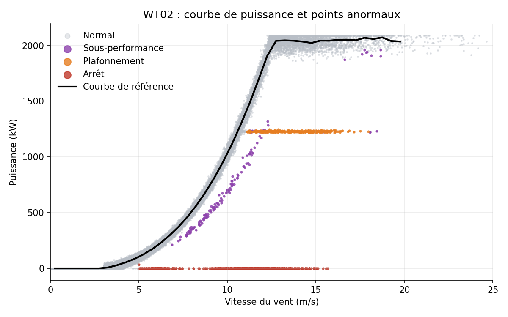
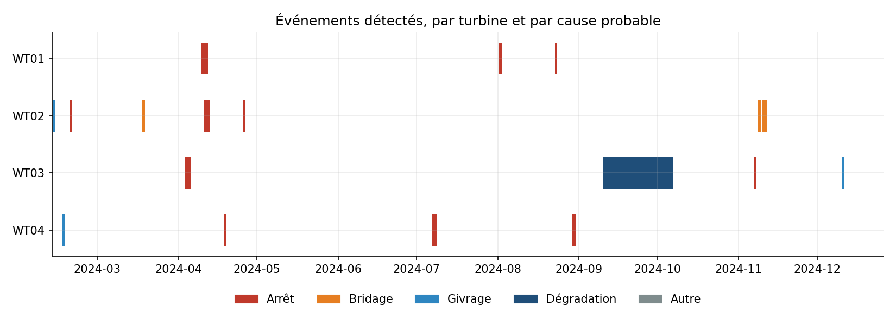
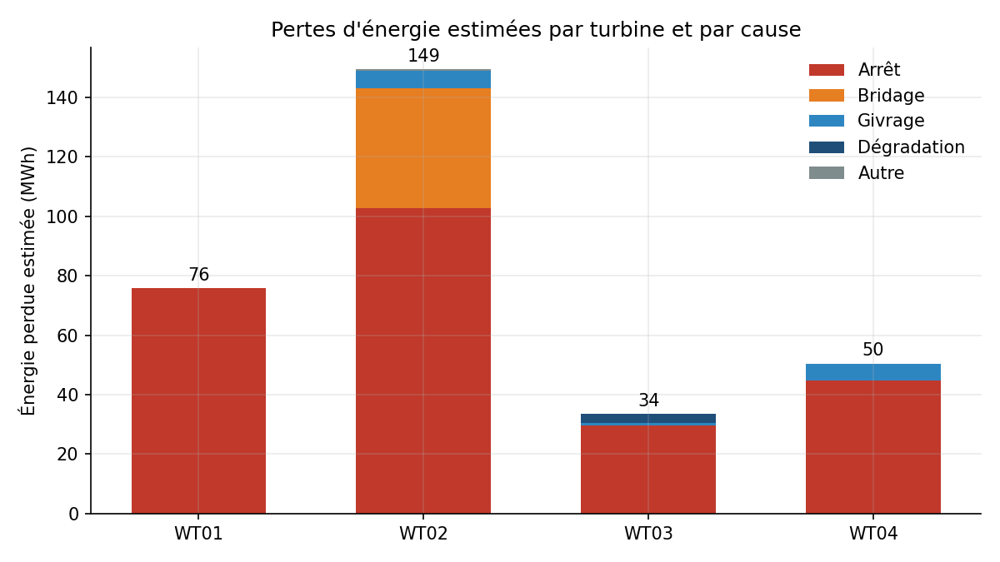
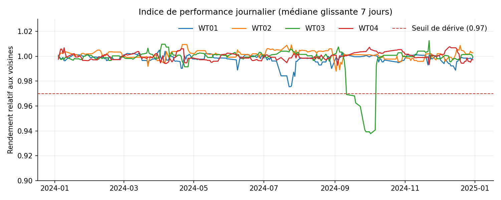

# Détection et diagnostic d'anomalies de performance sur des éoliennes

Ce projet personnel détecte les sous-performances d'éoliennes à partir de données SCADA au pas de 10 minutes. Pour chaque anomalie trouvée, il estime l'énergie perdue et propose une cause probable. Le diagnostic se fait de deux façons : par des règles métier, et par un agent LLM qui enquête lui-même dans les données.

> **Données.** Par défaut, le pipeline tourne sur un parc **simulé** de 4 turbines sur un an, dans lequel des anomalies connues ont été injectées. Cela permet de mesurer la qualité de la détection. Un chargeur est prévu pour des données réelles au format des données ouvertes du parc de La Haute Borne.

## Résultats sur données simulées

On simule 4 turbines de 2,05 MW sur un an, soit 210 240 pas de 10 minutes. Les 25 anomalies injectées sont des arrêts sur défaut, des bridages, des épisodes de givrage et une dérive lente.

| Indicateur | Valeur |
| --- | --- |
| Anomalies à impact détectées (rappel) | 17 sur 19 (89 %) |
| Événements détectés qui correspondent à une vraie anomalie (précision) | 100 % |
| Bonne cause attribuée, parmi les anomalies détectées | 100 % |
| Énergie perdue : vraie / estimée | 323 MWh / 309 MWh |
| Fausses alertes sur un an de données saines (5 tirages) | 0 |

Une anomalie est dite « à impact » si elle a coûté au moins 500 kWh. Un bridage à 60 % par vent faible, par exemple, ne change rien à la production et ne peut pas être vu.

Ces chiffres sont **optimistes**. Les anomalies simulées sont nettes, et le bruit des données réelles est plus fort et moins régulier. Il faut les lire comme un contrôle du bon fonctionnement de la méthode, pas comme une performance attendue en exploitation.







## Méthode

**1. Courbe de puissance de référence.** Pour chaque turbine, on calcule la puissance médiane par intervalle de vent de 0,5 m/s (méthode des intervalles). La médiane est robuste : quelques jours d'anomalies ne déforment pas la référence. La dispersion normale autour de la courbe est mesurée par l'écart absolu médian, ce qui donne un résidu normalisé à chaque pas de temps.

**2. Détection.** Il y a quatre détecteurs, du plus net au plus subtil :

| Détecteur | Règle |
| --- | --- |
| Arrêt | Production quasi nulle alors que le vent suffit |
| Plafonnement | Production bloquée sur un palier, nettement sous l'attendu |
| Sous-performance | Résidu normalisé sous −3 pendant au moins une heure |
| Dérive | Rendement journalier, rapporté à la médiane des turbines voisines, sous 97 % (médiane glissante sur 7 jours) |

Comparer chaque turbine à ses voisines retire les effets communs au parc : météo, densité de l'air, saisonnalité. Il ne reste que ce qui est propre à la turbine.



**3. Événements et pertes.** Les pas de temps anormaux consécutifs sont regroupés en événements. Les périodes de vent faible, où l'on ne peut rien juger, ne coupent pas un événement. Pour chaque événement, la perte vaut l'énergie attendue moins l'énergie produite.

**4. Diagnostic par règles.** Pour chaque événement, on calcule quelques indicateurs explicatifs : alarmes associées, température, écart de pitch au comportement normal, rendement des turbines voisines. On les combine ensuite avec des règles lisibles. Par exemple, une sous-performance par température négative oriente vers un givrage. Une dérive avec un pitch décalé de plus de 1° oriente vers un désalignement de pitch.

**5. Agent LLM (optionnel).** Un agent reçoit un événement et dispose de quatre outils : les indicateurs de l'événement, les alarmes, la comparaison aux voisines et l'historique de la turbine. Il choisit lui-même les outils à appeler, puis rend un diagnostic structuré (cause, confiance, justification, action). L'intérêt est de combiner les indices plus librement que des règles fixes, et de justifier la conclusion en langage naturel pour les équipes métier.

## Utilisation

```bash
pip install -r requirements.txt

python run_all.py                    # données simulées + évaluation
python run_all.py --data scada.csv   # données réelles (adapter les colonnes dans src/windad/data.py)

export ANTHROPIC_API_KEY=...         # pour l'agent
python run_all.py --agent 3          # l'agent diagnostique les 3 événements les plus coûteux

pytest                               # tests automatiques
```

Les résultats sont écrits dans `outputs/` : la table des événements avec leur diagnostic, l'évaluation et les figures.

```
src/windad/
  simulate.py     parc simulé avec anomalies injectées (vérité terrain)
  data.py         chargement de données réelles
  power_curve.py  courbe de puissance de référence et résidus
  detect.py       quatre détecteurs et regroupement en événements
  diagnose.py     indicateurs explicatifs et diagnostic par règles
  agent.py        agent LLM avec outils
  evaluate.py     rappel, précision, pertes vraies vs estimées
  plots.py        figures
tests/            tests pytest (dont la boucle de l'agent, avec un client simulé)
run_all.py        point d'entrée
```

## Limites et pistes

- **Les pertes des dérives sont sous-estimées** (3,1 MWh estimés contre 6,5 MWh réels). La médiane glissante réagit avec retard, et une partie de la baisse est absorbée par la courbe de référence. Une piste serait d'estimer la courbe sur une période de référence saine plutôt que sur toute l'année.
- **Les seuils sont fixés à la main.** Sur données réelles, il faut les recaler sur l'historique, ou les remplacer par un modèle de la puissance attendue qui tienne compte de plus de variables (densité de l'air, direction du vent, turbulence), par exemple par gradient boosting.
- **Un bridage léger ou par vent modéré passe inaperçu.** C'est attendu, puisqu'il ne coûte presque rien.
- **La qualité de l'agent n'a pas été évaluée.** Seule la boucle d'appel des outils est testée. Il faudrait comparer ses diagnostics à la vérité terrain sur plusieurs tirages, comme pour les règles.
- **Le passage à l'échelle** (des centaines de turbines, plusieurs années) se ferait naturellement avec PySpark, car tous les calculs se font par turbine et par jour.
